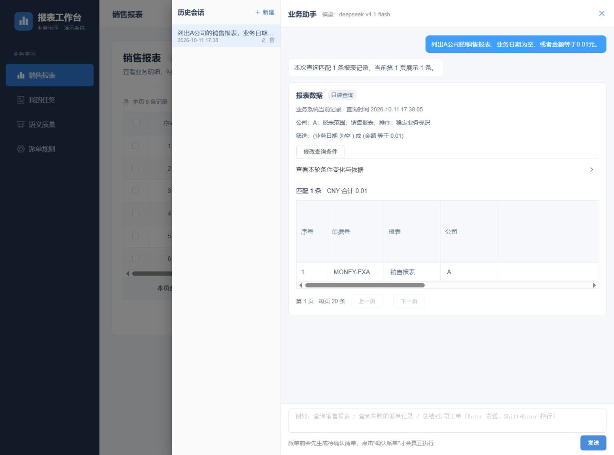

# P0 语义质量与交互验收

日期：2026-10-11，Asia/Shanghai。对应[实施计划](../P0语义质量与交互实施计划_2026-10-11.md)和[优化路线](../下一阶段优化路线评估_2026-10-11.md)。本报告只描述本轮 P0 的实现及实际执行结果，早期评审与失败按原日期、原基线保留。

**P0 已完成实现，最新完整回归和真实链路验收通过，本轮发现的功能缺陷均已修复并复验。** 最新 Java 实际执行 1,062 项、前端 163 项、评估工具 21 项通过；真实模型回放 54/54 轮、认证 HTTP 检查 7/7、最新真实浏览器 12 个检查点通过。浏览器夹具正常退出，最终隔离库清单恢复到执行前状态。这个结论限定于所列代码、工程语料和隔离数据，不表示任意自然语言或生产环境已经验收。

## 交付功能

| 工作包 | 已实现行为 | 关键边界 |
| --- | --- | --- |
| 阶段诊断与评估 | 记录 PURPOSE、PLAN、REVIEW 的模型、实际耗时、修正次数、契约与 Schema 指纹、词典版本依据及原生用量；支持版本化语料和可比回放 | 诊断仅本人及当前有权读取的会话可见；不持久化原始模型提示或响应；缺失计量和费用保持未知 |
| 业务词典 | 按数据域、公司、报表发布名称与字段别名、说明、单位、枚举、时区及财年口径；支持校验、版本冲突拒绝和历史 | 专用业务授权入口；复用现有版本表；发布递增相关目录版本，旧查询、预览及清单继续受到版本保护 |
| 查询解释与编辑 | 显示完整条件、来源与新增／保留／删除差异；编辑完整 AND/OR、上下界、集合及空值条件 | 提交绑定当前查询引用；刷新可恢复，旧标签页请求拒绝；完整编辑进入三个模型阶段，不绕过业务预检或独立复核 |
| 结构化澄清 | 公司、报表、字段及枚举候选来自当前目录和权限；累计保存已经完成的选择并继续原任务 | 旧回复及伪造值拒绝；保留其他真实歧义；选择不等于确认派单 |
| 用户反馈 | 区分理解错误和正常查询调整，关联具体诊断，按游标分页；同一请求号重复提交返回同一记录 | 同号不同内容或目标冲突；始终待审核，不自动修改词典或成为训练标签 |
| 条件与来源保护 | 核对明确逻辑连接及括号，分离 PREVIEW 与 QUERY_ROWS／QUERY_ALL 的准备规则 | 程序只拒绝可证明的冲突，由模型在原预算内修正；当前权限、资格、确认、幂等及执行版本约束不变 |

没有升级前端框架、组件库或依赖，没有新增表结构、演示库或历史数据兼容协议。Demo 账号生命周期问题继续按仓库约定暂缓；正式外部认证尚未接入。操作说明见[语义质量与业务词典](../语义质量与业务词典.md)。

## 运行基线与最新程序回归

真实链路为 `real,mcp`、`agent.semantic.mode=active`，实际模型 `deepseek-v4.1-flash`，原生 JSON Schema，thinking 关闭，temperature 0；业务读取和执行通过认证 HTTP MCP。本机合成业务数据不等于外部 ERP 数据。前端使用现有依赖的生产构建及用户手动启动的预览进程，浏览器操作由实际页面完成。

以[当前源码指纹](p0-semantic-quality-2026-10-11/current-source-manifest.json)定位工作区版本，以[套件清单](p0-semantic-quality-2026-10-11/module-regression.json)和[整轮退出记录](p0-semantic-quality-2026-10-11/module-regression-exit.json)定位程序测试。完整回归命令为已经取得本轮数据库授权后执行的 `tools/test-regression.ps1 -AllowIsolatedDatabases`。

| 范围 | 登记 | 实际执行通过 | 条件跳过 | 失败／错误 |
| --- | ---: | ---: | ---: | ---: |
| backend | 1,013 | 1,005 | 8 | 0／0 |
| business-service | 63 | 57 | 6 | 0／0 |
| Java 合计 | 1,076 | 1,062 | 14 | 0／0 |
| 前端逻辑与生产构建探针 | 163 | 163 | 0 | 0／0 |
| 语义条件比较器 | 12 | 12 | 0 | 0／0 |
| 语义质量评估器 | 5 | 5 | 0 | 0／0 |
| 调查评估比较器 | 4 | 4 | 0 | 0／0 |

前端生产构建通过。14 项跳过包含按环境开启的真实模型、浏览器及其他专项，不能计入通过数；本轮另执行的真实回放和浏览器夹具单独列在下文。新增逻辑连接测试及其他专项已包含在 Java 总数中，不重复相加。

注释门禁通过，检查 223 个生产类型、225 个实体字段、44 个请求／表单字段、131 个 record、38 个前端模块，以及 38 张表、456 个字段清单。真实模型文档门禁和差异空白检查通过；静态检查不代替业务正确性或浏览器验收。

## 真实模型与 HTTP 验收

回放器从独立报表页读取来源事实，分别核对动作、公司／报表范围、完整条件逻辑、排序、记录身份、金额、总数、澄清候选及旧引用拒绝。每次回放使用新证据文件；两次主回归的语料、评分器、来源、授权和日期口径相同，[比较结果](p0-semantic-quality-2026-10-11/replays/stability-final.json)为可比且无退化。

| 最新批次 | 通过轮次 | 实际模型调用 | 证据 |
| --- | ---: | ---: | --- |
| 逻辑连接补充 v1 | 6／6 | 23 | [逻辑回归](p0-semantic-quality-2026-10-11/replays/logic-first.json) |
| 主回归 v2 第一次 | 16／16 | 47 | [第一次](p0-semantic-quality-2026-10-11/replays/regression-first.json) |
| 主回归 v2 第二次 | 16／16 | 49 | [第二次](p0-semantic-quality-2026-10-11/replays/regression-second.json) |
| 日期与意图边界 v1 | 8／8 | 30 | [边界回归](p0-semantic-quality-2026-10-11/replays/temporal-intent-first.json) |
| 已见预留集 v1 | 8／8 | 24 | [已见回归](p0-semantic-quality-2026-10-11/replays/reserve-seen-first.json) |
| 合计，含重复稳定性回放 | **54／54** | **173** | [验收汇总](p0-semantic-quality-2026-10-11/acceptance-summary.json) |

54 轮包括 43 个明确查询、7 个预期澄清和 4 个模型调用前的旧输入拒绝。43 个明确查询均最终符合期望，其中 **27／43（62.8%）一次通过，16 轮经过模型修正后完成**。全部回放共 23 次阶段修正调用，没有将修正后成功写成一次通过。原生计量覆盖 173／173 次调用，输入 2,476,345 token、输出 61,454 token，费用未知。

本批端到端耗时 p50 为 10,884 ms、p95 为 17,501 ms、p99 为 20,664 ms；这是包含预期拒绝和澄清的有限样本分布，不是生产 SLO。企业业务方尚未独立审核语料。预留集已用于定位并修复 OR 问题，因此后续结果明确记为“已见回归”，不能称为盲测或独立泛化正确率。

[真实认证 HTTP 检查](p0-semantic-quality-2026-10-11/http-final.json)为 7／7：本人诊断读取、未认证与另一账号拒绝、反馈并发幂等、异内容／异目标冲突、词典授权过滤、只读账号拒绝发布及严格表单类型、结构化回复的数字值拒绝。此检查没有改写来源业务数据，也不代替浏览器操作。

## 最新真实浏览器闭环

[12 个检查点](p0-semantic-quality-2026-10-11/browser-checks.json)均通过，对应 AX 原件保存在证据目录的 `browser/` 下。

| 场景 | 实际观察与核对 |
| --- | --- |
| 原失败 NULL／OR | “业务日期为空，或者金额等于0.01元”显示两个 OR 分支，返回 MONEY-EXACT-02 一条，合计 0.01 |
| AND 及括号变体 | 同样两个条件改为 AND 后为零条；括号内 OR 与外层产品排除正确展开，每支都保留排除条件 |
| 完整编辑与刷新 | 从编辑器将 OR 第二分支金额改为 32000，原分组和两个产品条件保留，返回 SO2026002；刷新重开后仍准确，旧卡片只读 |
| 结构化字段选择 | 选择 amount 后继续 A 公司销售报表的金额降序查询，返回 6 条，不再追问已选择字段 |
| 诊断与反馈 | 显示三阶段、实际模型、耗时与原生 token；费用未知；“正常调整查询”重复保存只保留同一条待审核记录 |
| 取消与版本失效 | 首张清单取消；再次准备后发布词典版本 2，旧清单在有效期内以 `CATALOG_CHANGED` 失效；历史为 2／1／0 |
| 新来源恢复与确认 | 重新查询后，原失败原文可以从新查询重新核验并准备 SO2026001 单条清单；浏览器确认后成功 1 条，失败 0 条 |

[只读阶段快照](p0-semantic-quality-2026-10-11/browser-readonly-before-preparation.json)的预览、清单和业务请求均为零。[版本失效快照](p0-semantic-quality-2026-10-11/browser-version-invalidated.json)保留 CANCELLED 和 EXPIRED 清单，确认时间均为空，业务请求仍为零。[新清单待确认快照](p0-semantic-quality-2026-10-11/browser-pending-before-confirmation.json)仍为零次业务请求，只有一条目标，金额 `13800138000.00`。

[最终数据库快照](p0-semantic-quality-2026-10-11/browser-backend-final.json)确认一次业务请求、一次成功执行、执行版本 1，取消和失效清单保持原状态；[夹具退出](p0-semantic-quality-2026-10-11/browser-fixture-exit.json)为 0。控制文件仅用于独立读取／断言和结束夹具，查询、编辑、选择、词典发布、取消与确认均由真实浏览器操作完成。

## 失败保留及共同修复

完整批次摘要、原失败用例及评分指纹见[历史回放归档](p0-semantic-quality-2026-10-11/history/replay-results-and-failures.json)，浏览器原失败见[第二夹具记录](p0-semantic-quality-2026-10-11/history/browser-second-checks.json)。没有覆盖旧失败、混算不同评分器成绩，或将停止夹具写成正常通过。

| 原事实 | 根因与修复 | 最终验证 |
| --- | --- | --- |
| 首轮主语料 13／16 | 公司候选期望漏掉实际授权 C，公司／字段选择后仍反复追问。期望改为独立授权目录；程序累计保存已解决维度，并由三个阶段继续原任务 | 最新两次主回归均 16／16；浏览器字段选择完成 |
| 浏览器改上界后仍出现旧值 | 共享前端发送接口漏传 `queryEdit` 和 `clarificationReply`。修复解构与 JSON 请求体，先用传输测试复现，再复验完整编辑 | 上下界、OR 分组、清空、旧引用拒绝和刷新恢复有程序及浏览器证据 |
| 第二夹具 15／16 | 字段候选将来源 `saleDate` 与投影 `date` 误判为不同。候选、条件、排序、分组共享 REPORT 域的明确来源字段等价关系，公司／报表／枚举仍严格比较 | 保留原始评分失败；新评分器下重新调用真实模型，不冒充旧响应已重跑 |
| 同夹具曾出现 10／16 | 绝对九月漂移为当前十月，待选择参数误判为 HELP，造成后续编辑级联失败。共同契约明确绝对日期、具体任务参数澄清及完整编辑输入的优先性 | 主回归两次通过；闰月、跨年、公历年度、绝对区间、字段选择和完整替换 8／8 |
| 新查询准备被旧预览阻止 | 模型把 PREVIEW 的重新展示要求误用于 QUERY_ROWS。将准备前提按来源传入，继续保留执行层权限、资格、版本与确认保护 | 第三及第四夹具均复验原文并完成确认闭环；[原模型输出](p0-semantic-quality-2026-10-11/history/model-source-and-logic-failures.json)保留 |
| 第三夹具预留集 7／8 | 规划正确 OR，独立复核虽逐项引用正确条件，却忽略中间“或者”并改成 AND。新增冻结期望前的明确逻辑连接校验，并补充复核的组合证据要求 | 新增 21 项程序测试先出现 17 失败／1 错误，修复后全部通过；最新已见预留 8／8、逻辑变体 6／6及浏览器原文／变体通过 |

逻辑校验只对同一作用域内至多 12 个、具备唯一且不重叠本轮证据的条件核对明确连接与括号。它将条件视为独立真假值，不依赖当前数据碰巧相同；值内的连接词不参与分组。重叠／重复引用、继承条件、整体否定、未明确优先级的混合表达和超预算情况仍由真实模型复核。它不从关键词生成计划，也不自动改条件或替用户确认。

## 清理与生产边界

本轮已经取得隔离测试库创建、写入、测试和清理的明确授权。[38 个确切目标](p0-semantic-quality-2026-10-11/database-exact-targets.json)属于本轮各次回归及浏览器夹具，最终均不存在。[执行前清单](p0-semantic-quality-2026-10-11/database-before.json)与[最终清单](p0-semantic-quality-2026-10-11/database-final.json)完全一致；固定演示库 `report_demo` 及执行前已有的 `mcp_it_9594cc3f508942e8ac1973eeefcba919` 均保留，没有清空或迁移它们。

夹具后端已正常结束。用户手动启动的 5196 前端预览终端可按 Ctrl+C 关闭。凭据文件及原始完整模型上下文未放入证据归档或版本库；验收结束时，4 个临时凭据文件的自动删除曾被审批拒绝，当时未计为已删除。后续用户手动清理及复核结果见本节末的补充记录。

正式企业身份、外部 ERP／工单闭环、生产容量、告警送达、备份恢复和灾备仍待实际接入或验收。后续语义工作应优先提高明确查询一次通过率、减少重复上下文和不必要修正，并引入业务方独立审核语料；本批终态全部通过不替代这些工作。

证据清单及哈希见 [evidence-index-final.json](p0-semantic-quality-2026-10-11/evidence-index-final.json)。验收时原始运行日志位于本机已忽略的 `.runtime/p0-semantic-quality-2026-10-11/`；后续按已核实的临时文件清单删除了有归档副本的指定原件，未完整归档的原始证据继续保留。本报告使用经过凭据检查的指定证据副本。

后续临时文件清理补充（2026-10-11 18:45，Asia/Shanghai）：用户于 18:44 手动执行已核实的清理脚本，成功删除 473 个临时文件，包括 4 个临时凭据。独立只读复核确认目标剩余为零，161 个原始证据仍在且大小一致，445 份正式归档哈希全部通过，长期配置及前端构建与依赖保留。执行结果与此前审批阻断事实均保存在[临时文件清理记录](temporary-cleanup-2026-10-11/README.md)中；这不改变上方已完成的数据库清理和验收结论。
