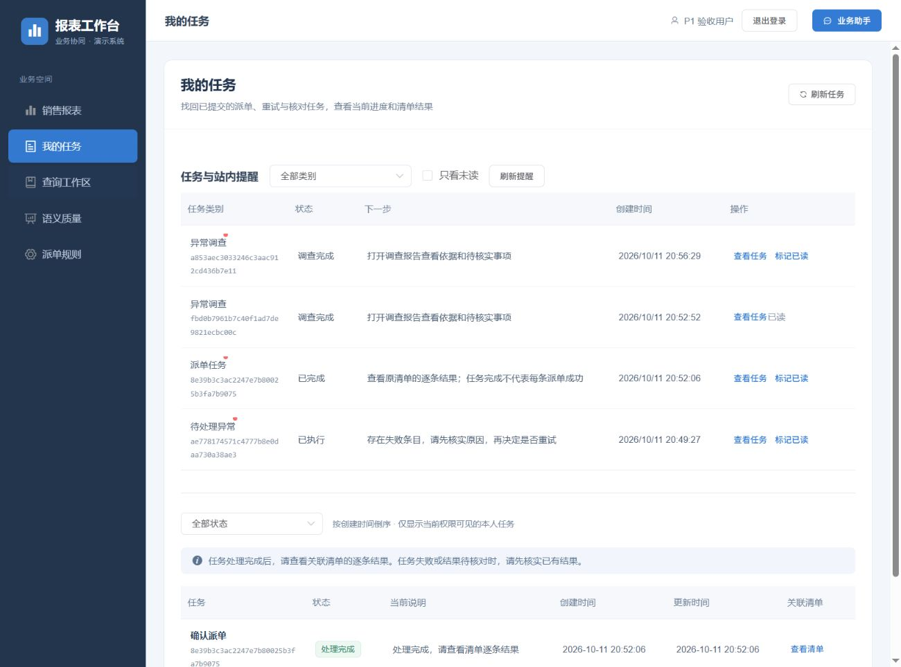

# P1 查询工作区实现与验收

日期：2026-10-11，Asia/Shanghai。代码基线为 `1e4a7d1`，本轮变更尚未提交。承接 [P1 实施计划](../P1查询工作区实施计划_2026-10-11.md)，操作说明见[查询工作区与日常分析](../查询工作区与日常分析.md)。

**本轮 P1 四个工作包已经实现，完整回归、专项和真实链路验收通过，列明范围内发现的功能缺陷均已修复并复验。** 最终 Java 实际执行 1,080 项、前端 186 项、评估工具 21 项通过；独立 P1 专项 15 项通过。浏览器保留主阶段和补充阶段的检查记录及历史失败，不把复测次数当作独立功能数量。

本轮没有重建 `report_demo`。6 个 P1 隔离库以及两轮完整回归记录的 32 个专用目标均已不存在，执行前所有库保留。代码定位见[当前源码指纹](p1-query-workspace-2026-10-11/current-source-manifest.json)，证据定位见[完整索引](p1-query-workspace-2026-10-11/evidence-index.json)。该结论限定于当前源码、合成业务数据和列明的真实链路，不表示任意自然语言或生产环境已经验收。

## 实现范围

| 能力 | 已实现的行为与边界 |
| --- | --- |
| 安全条件下推 | 以真实 JDBC 类型证明为前提参数化下推，保留共同 Java 谓词；无法证明等价的条件继续有界求值 |
| 完整查询快照 | 保存有序完整事实、来源、时间、定义与权限指纹；分页稳定，过期、撤权、口径改变及缺行明确拒绝 |
| 私人常用查询 | 支持固定日期和执行时重算上海时区上月；重跑重新授权，更新/删除检查定义版本 |
| 异步 CSV | 持久队列、幂等请求、取消、令牌租约与有限恢复；受控下载，所有单元格统一文本保护 |
| 指标与对比 | 完整结果的分组、精确金额及均值、日/月趋势、完整期间同比/环比、两份查询集合与金额差异 |
| Top N | 从完整授权结果稳定排名，准备时重核事实与规则；生成原有待确认清单，显式确认后才执行 |
| 任务与提醒 | 待确认、异常、派单、调查、导出统一入口；状态去重、已读校验、恢复用户选择的历史调查 |
| 当前基线 | 新增六张表，目标为 44 张业务表、512 字段；统一中文职责、字段与数据库注释 |

自然语言条件变更仍经过真实模型目标判断、规划、业务预检和独立复核。结构化分页、保存、分析及排名不增加模型解析调用。前端依赖版本保持不变；Demo 自带账号生命周期按仓库约定暂缓，不能视作已经接入正式企业认证。

## 完整回归与目标结构

最终完整回归于 2026-10-11 21:22–21:24（上海时区）执行，`tools/test-regression.ps1 -AllowIsolatedDatabases` 退出 0。数量从 Surefire XML 与 Node 测试输出提取，见[分层汇总](p1-query-workspace-2026-10-11/final/regression-summary.json)、[逐套件及用例清单](p1-query-workspace-2026-10-11/final/regression-final-suites.json)和[整轮退出记录](p1-query-workspace-2026-10-11/final/regression-execution.json)。

| 范围 | 登记 | 实际执行通过 | 条件跳过 | 失败／错误 |
| --- | ---: | ---: | ---: | ---: |
| backend | 1,031 | 1,023 | 8 | 0／0 |
| business-service | 78 | 57 | 21 | 0／0 |
| Java 合计 | 1,109 | **1,080** | **29** | **0／0** |
| 前端逻辑与组件注册检查 | 186 | 186 | 0 | 0／0 |
| 调查评估比较器 | 4 | 4 | 0 | 0／0 |
| 查询条件语义比较器 | 12 | 12 | 0 | 0／0 |
| 语义质量评估器 | 5 | 5 | 0 | 0／0 |

29 项条件跳过包含 15 个 P1 专项入口和 14 个既有真实模型、浏览器等独立专项，均未计为通过。本轮实际执行的 P1 专项在下节单列；纯逻辑下推、分析和 CSV 测试已经包含在 Java 总数中，不重复相加。

`SchemaCommentsDatabaseTest` 在新建专用库执行最新 V1，核验 44 张业务表和 512 个字段的实际 MySQL 注释与清单逐项一致；初始化守卫、规则、租约、幂等、来源身份、权限、调查及 HTTP MCP 回归通过。新快照、明细、常用查询、导出队列、容量锁、已读状态六张表及金额/日期索引在专项中实际使用。

注释检查覆盖 232 个生产类型、225 个实体字段、44 个请求/表单字段、143 个 record、41 个前端模块及 44 表/512 字段清单。人工复核了身份刷新、快照失效与缺行、查询下推、精确计算、异步认领/续租/取消、Top N 重新核验、用户确认及恢复边界；静态检查不代替这些业务判断。

[最终门禁记录](p1-query-workspace-2026-10-11/final/final-gates.json)覆盖注释、163 份真实模型文档、当前 V1 基线、当前协议、14 页图表生成一致性及已跟踪/新增源码空白检查。新增文件检查器曾把 `git diff --no-index` 的正常差异退出码 1 误判为错误；已保留该工具失败记录，改为结合诊断输出与退出状态判断，22 个新增文本文件通过，没有修改源码来迎合检查器。

前端生产构建通过。Vite 保留入口包 540.91 kB（gzip 138.98 kB）超过既有 500 kB 提示阈值的警告，未通过放宽阈值隐藏提示；它不是测试失败或容量验收结果，后续可按实际加载性能继续拆包。没有升级框架、组件库或依赖。

## 真实模型与 P1 专项

最终 P1 专项于 2026-10-11 21:06（上海时区）结束，[15 项全部通过](p1-query-workspace-2026-10-11/final/integration-results.json)：13 个数据库/HTTP 场景、1 个真实模型查询及纠正场景、1 个等待实际浏览器操作完成的夹具。浏览器夹具用例本身不是全部交互断言的替代。前序失败、[12 项边界扩展](p1-query-workspace-2026-10-11/boundaries/integration-results.json)与最终验证分别保留，不累加为新增独立用例数。

13 个数据库/HTTP 场景覆盖不可变分页与归属、下推等价、常用查询版本与权限、导出幂等/精度/下载撤权、取消及失租恢复、提醒去重与归属、完整 Top N 及排名变化、认证及严格表单、快照缺行、空报表范围展开、固定规模测量、确认前来源变化、工单来源与派单边界。

真实链路为 `real,mcp`、`agent.semantic.mode=active`、模型 `deepseek-v4.1-flash`、原生 JSON Schema、thinking 关闭，以及认证 HTTP MCP。[最终真实模型场景](p1-query-workspace-2026-10-11/final/live-evidence.json)先查询金额大于 100 元，得到 20 条，再将下限改为 110 元以上，得到 10 条，两次均每页 5 条。[原始模型记录](p1-query-workspace-2026-10-11/final/model-evidence.json)包含 7 次调用，第二轮含一次有界修正，没有把修正后成功写成一次通过。两轮各自的结构化翻页均没有增加模型调用。数据库与纯逻辑测试只证明对应状态机或计算行为，不等同真实外部 ERP 验收。

## 真实浏览器闭环

[原始检查记录](p1-query-workspace-2026-10-11/main/browser-checkpoints.json)与[阶段及失败分类](p1-query-workspace-2026-10-11/final/browser-check-summary.json)区分如下：

| 阶段 | 检查记录（含复测） | 通过记录 | 保留的历史失败 | 证据范围 |
| --- | ---: | ---: | ---: | --- |
| 主阶段 | 36 | 33 | 3，均有后续复验 | 查询、保存、分析、导出、Top N 确认及提醒恢复 |
| 最终补充 | 12 | 12 | 0 | 来源变化、两次调查与指定历史恢复、工单快照、最终 CSV 与失效 |

共 48 条记录中 45 条通过、3 条为历史失败；不能写成 48/48。最终补充阶段包含 37 个预期文本检查项。其 AX 原件为 `main/browser-37.txt` 至 `main/browser-48.txt`：采集函数沿用主目录，阶段依据时间和检查编号区分，不以文件夹名字代替执行范围。

浏览器主阶段覆盖 120 行完整查询、分页与刷新恢复、固定/上月常用查询、分析和对比、完整 CSV 下载、Top 3 清单及提醒。[取消确认后的核对](p1-query-workspace-2026-10-11/main/browser-check-cancel-confirm-no-writes.json)显示业务写入为 0；[明确确认后](p1-query-workspace-2026-10-11/main/browser-check-confirmed-three.json)为 3，[刷新及排名重放后](p1-query-workspace-2026-10-11/main/browser-check-rank-replay-no-duplicate.json)仍为 3。合计为 `7141.20`，均值为 `59.51`，实际候选为 P1-119、P1-118、P1-117。

分组保留 `Alpha`、`alpha ` 和 `=1+1` 三种不同文本，分别为 60 条/3540.60、59 条/3599.59、1 条/1.01；按日/月趋势、期间不足及基期为零的不可计算状态均核验。派单后再次查询并对比，准确显示 3 条状态/派单字段变化，金额差额为 0。完整 CSV 实际下载 120 条，校验首尾记录、总金额和公式保护。

补充阶段在清单准备后改变来源金额，明确确认得到 `SKIPPED / RECORD_CHANGED`，业务写入仍为 0。[最终只读核对](p1-query-workspace-2026-10-11/final/probe-browser-final.json)记录两次由用户界面明确发起的真实模型调查均完成，分别使用 5 次模型/7 次工具和 5 次模型/8 次工具；两次远端 MCP 调用均为 0，因为跳过条目没有提交请求号，读取的是本地执行证据，不能宣称这两次验证了远端结果回查。[指定历史调查恢复](p1-query-workspace-2026-10-11/final/probe-after-history-restore.json)仍为所选旧调查，没有自动切换或新增调查；调查没有把尚未核实的规则原因写成确定事实。

工单工作区验证 WO-DEMO-001 待审批与 WO-DEMO-004 已完成两条演示流程的快照步骤切换。[最终 CSV 下载检查](p1-query-workspace-2026-10-11/final/browser-final-download-check.json)核验 2 条、合计 `108500.00`，SHA-256 为 `0eb3d126d883f4657a42fb8ea35669c052082e0c417c665ad01ca4496fdbfb12`，与数据库一致。删除快照后 URL 清掉运行和页码，刷新无旧详情，相关导出从提醒中隐藏。

## 失败事实与修复

本轮保留首次失败及最终复测，不只保存通过结果。

| 首次事实 | 根因与共同修复 | 最终验证 |
| --- | --- | --- |
| 首轮 8 项集成均失败 | JDBC 对 DATETIME 返回 LocalDateTime，强制 Timestamp 转换失败；统一按字段 UTC 语义转换 | 最终 15 项通过，实库时间与浏览器显示一致 |
| CSV 单测及后续审查发现保护范围不完整 | 脱敏 JSON 类型转换需显式处理；统一在单元格编码处保护业务值、标题与元数据 | 逻辑测试、完整导出与最终实下载通过 |
| 常用查询运行后刷新回到旧运行 | 运行与页码未共同同步 URL；统一路由恢复，过期/删除清理，保留页面实例的请求失效控制 | 保存、运行、翻页、刷新、失效均复验 |
| 查询卡片时间相差 8 小时 | UTC 快照时间被当作本地时间；统一规范化，提醒各来源在投影时转换 | 同一观测时间及提醒排序复验 |
| 月份输入未显示 | Element UI 组件未注册；补齐 DatePicker/Badge，增加全部模板组件注册覆盖检查 | 月份分析与提醒显示、186 项前端回归通过 |
| 700 行快照缺序号 10 仍能补出完整页 | 分页 LIMIT 从后续序号补齐；严格按序号区间读取，所有完整计算拒绝缺行 | 分页、分析、导出均明确拒绝 |
| 工单工作区查看进度无响应 | 工作区未接原聊天的按钮事件；改为展开同份快照步骤 | 两条不同工单切换与来源边界通过 |
| 空报表范围及表单边界问题 | 冻结实际展开的授权报表定义；已读表单显式 null 统一按严格契约拒绝 | HTTP 422、权限/口径与完整快照专项通过 |
| 全仓首次回归 1 失败、1 错误 | 两个旧测试替身没有执行新增查询入口的默认委派，返回空集合；测试中启用真实默认委派，保留预算/唯一目标断言 | 相关 8 项复验通过，最终全仓 1,080 项通过 |

原始记录见[首轮集成失败](p1-query-workspace-2026-10-11/main/integration-failure-01.json)、[快照缺行复现](p1-query-workspace-2026-10-11/gap-failure/integration-results.json)、[首次全仓用例结果](p1-query-workspace-2026-10-11/final/regression-round1-suites.json)。分析/对比参数改变后立即清除旧结果，已执行清单标题与状态同步，调查及提醒增加编号/创建时间；相关前端回归已覆盖。

快照分页原实现按 `seq > offset LIMIT size` 读取，中间明细缺失时会从下一页补齐。以 700 行快照删除序号 10 实际复现后，统一改为严格序号区间；最终分页、分析和导出均拒绝不完整快照。此修复针对共同读取契约，不为单个样例补特例。

浏览器记录还保留一次差异无障碍树检查器误判和一次加载遮罩拦截点击；前者修正取证方式，后者等待实际遮罩退出后复验。这些测试工具问题与真实产品失败分别标记。[全仓预检首次失败](p1-query-workspace-2026-10-11/final/regression-preflight-failure.log)是报告链接尚未落地，当时没有进入 Java 回归；补齐报告后重新执行。第 14 页图表初次渲染文字换行/边框交叠，缩短标签并同步重新生成后完成四张改动 SVG 的视觉核对，HTML、Mermaid、draw.io 以生成一致性检查为证，不另称图表阅读器浏览器验收。

## 固定规模测量

[最终本机夹具](p1-query-workspace-2026-10-11/final/fixed-scale-evidence.json)在 5120 条合成来源中查询金额大于 5070 的记录，得到 50 条，精确合计 `254725.50`。全量 HTTP 请求测得 721 ms，下推请求测得 19 ms；进入共同谓词的记录数为 50。EXPLAIN 使用 `idx_query_amount` 的 range 路径，估计 50 行。[前一轮测量](p1-query-workspace-2026-10-11/boundaries/fixed-scale-evidence.json)为 675 ms/20 ms，保留原值。上述为单次固定规模测量，应用收到的行数不等同物理扫描量，也不是生产容量、p95 或跨机器性能承诺。

## 数据与交付边界

用户已明确授权本轮专用隔离库创建、写入、测试和清理。P1 夹具使用 `p1_workspace_it_<UUID>`，复用回归夹具沿用各自专用前缀；[准确名称与清理核对](p1-query-workspace-2026-10-11/final/database-cleanup.json)记录 6 个 P1 库及两轮各 16 个回归目标。结束后的库名清单与执行前一致，`report_demo`、既有 `mcp_it_9594cc3f508942e8ac1973eeefcba919` 和系统库均保留。

本轮未重建 `report_demo`，未对旧库修复 Flyway 校验和，也未引入历史运行数据兼容。最新 V1 空库结构、全部注释与共同业务回归已经完成。现有本地演示库进入新基线仍需要明确的数据重建方案与针对该操作的授权，不能把本轮隔离库授权解释为允许清空演示库。

本轮原始证据按白名单复制并记录 SHA-256，归档排除临时登录凭据和控制脚本。[历史证据核验](p1-query-workspace-2026-10-11/historical-evidence-integrity.json)确认前序三个归档目录的 454 个已提交文件字节不变。[凭据扫描](p1-query-workspace-2026-10-11/sensitive-data-scan.json)覆盖归档文本及本轮源码变更；保留对既有 Demo 测试字面量的历史说明，不将账号暂缓范围改写成已经修复。

[临时文件清理](p1-query-workspace-2026-10-11/final/temporary-cleanup.json)核验两份临时登录凭据、四个夹具控制文件、两个只读取证脚本及两个下载副本均已删除；下载副本删除前逐一核对归档 SHA-256。初始复合清理命令被自动审批拒绝且没有执行，随后使用精确字面路径的原生 PowerShell 清理获准并完成，没有改用其他删除机制。[最终进程状态](p1-query-workspace-2026-10-11/final/final-process-state.json)确认本轮 53380 后端已停止，用户原有 5196 前端预览进程保留；浏览器临时页已关闭。长期模型配置和 `tools/env.local.cmd` 保留，原始证据与归档副本保留。

正式企业身份、外部 ERP/工单、生产容量、多实例部署、实际告警送达与灾备仍待相应环境验收。本报告的完成标准是在列明的范围内无遗留已知失败，不表示任意环境下绝无缺陷。
