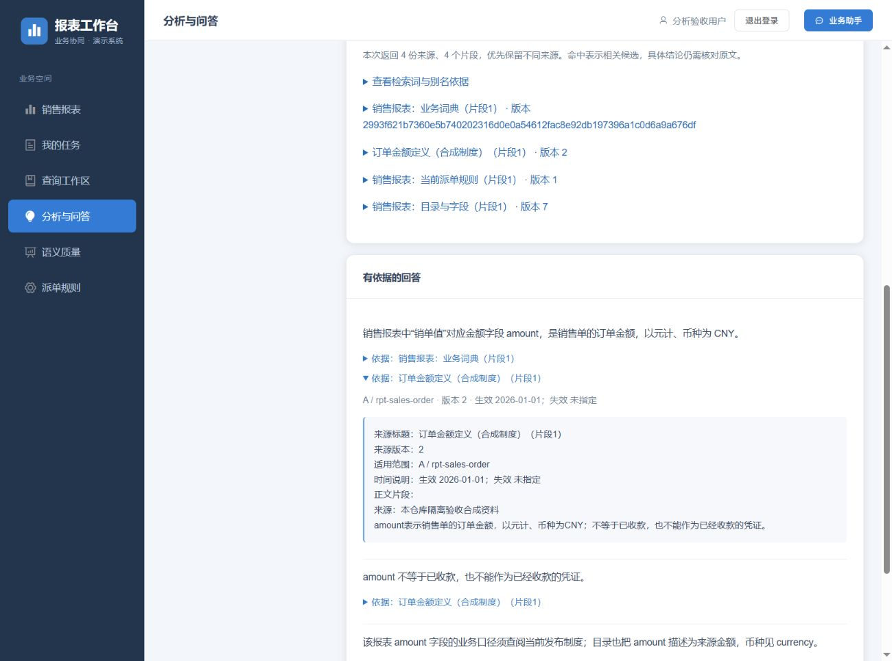
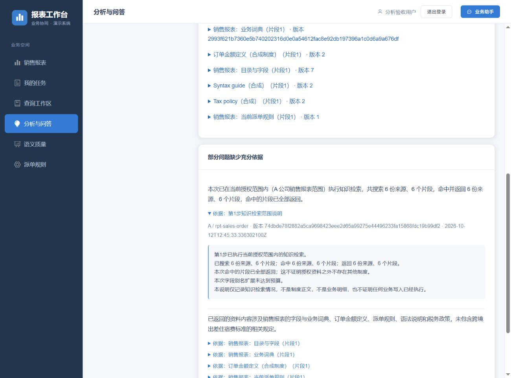

# 知识检索准确性与试查实现与验收

日期：2026-10-12（Asia/Shanghai）。本轮基于已经提交并推送的 P2 提交 `286a25579176c01a6e9835d4897473f5a5bede7a`，完成[检索准确性与试查计划](../知识检索准确性与试查实施计划_2026-10-12.md)。P2 历史报告和原始归档保持原样；本报告只描述本轮新增能力、实际失败及后续复验。

运行链路为 `real,mcp`、`agent.semantic.mode=active`、`deepseek-v4.1-flash`、原生 JSON Schema、thinking 关闭，以及带认证的 HTTP MCP 业务服务。数据来自明确授权的本仓库隔离 MySQL 库与合成制度，实际使用本机 Redis。没有接入外部 ERP、真实工单或正式企业身份系统，没有开展生产容量、灾备和生产部署准入。本阶段继续保留既有前端与依赖版本，Demo 账号生命周期仍按仓库约定暂缓。

## 最终实现

| 能力 | 实现与边界 |
| --- | --- |
| 完整词界 | NFKC、大小写及空白规范化；非汉字单词、数字、下划线按完整词界匹配，`tax` 不再召回 `syntax`、`tax_id` 或 `taxé`。中文使用按 code point 生成的二字、三字词项 |
| 有界别名扩展 | 只读取同租户、公司、报表内已验证词典的字段名和 `aliases`；名称须完整出现在原检索问题中。不递归，不使用 `meaning`、单位、枚举或公司别名猜测同义关系 |
| 来源均衡 | 引用契约必填 `originId`，所有切片保留原始来源；词项频率按独立来源计算。先每个命中来源选一片，再逐轮补充，避免一份长资料挤掉其他资料 |
| 明确检索预算 | 最多 256 个直接词项、64 个扩展词、1600 个候选片段；一次最多返回 12 个知识片段，每片可完整引用且不超过 2000 字符。候选与扩展截断分别说明 |
| 管理员试查 | `POST /api/analysis/knowledge/search` 只接收公司、报表和问题，拒绝客户端来源、时间、词典、预算及重复/未知字段；前后重新核对权限和知识指纹 |
| 试查只读 | 与实际分析复用检索逻辑，不调用模型、不读取业务行、不创建分析任务、不持久化试查问题。草稿、未来、过期或停用资料不成为现行回答依据 |
| 共享展示 | 分析步骤和维护页面使用 `KnowledgeResults.vue`，显示实际来源/片段计数、直接命中词、别名依据、版本、范围和原文；全部内容按文本转义 |
| 迟到响应保护 | 修改问题、切换范围、刷新、保存、发布、停用或销毁页面时撤销旧请求回写权；空范围立即清空旧资料列表 |
| 可引用的覆盖事实 | 回答与独立复核收到相同的 `performed` 和分开命名的来源/片段计数。每个实际知识步骤生成独立的检索范围证据；计量说明不占知识正文预算，也不表示读取业务明细 |
| 语义复核 | 未执行检索与执行后无命中分开；公司/报表是知识资料的授权边界，不能由报表名称推断正文主题不存在。复核同时检查结论和限制说明，判定须与理由一致；程序不把矛盾的拒绝自动改成批准 |

模型复述检索数字时仍须显式选择相应证据编号，程序继续严格核对数值和引用，独立模型继续复核语义。截断时缺少限制说明的回答被拒绝，不自动补写结论或引用。执行配置版本为 `2`，模型、提示、Schema 和预算仍参与执行指纹。现行任务权限、取消令牌、租约、幂等请求号、规则及资料版本保护均保留。

本轮没有修改 SQL 目标结构，仍为 **47 张业务表、557 个字段**；没有为了兼容旧数据增加双读、旧协议或迁移适配，也没有重建 `report_demo` 或修复旧库 Flyway 校验和。

## 分层验证

最终全仓回归退出码为 0：Java 登记 **1,219 项**、实际执行 **1,151 项**，68 项按专用夹具开关跳过，0 失败、0 错误；其中后端执行 1,094 项，业务服务执行 57 项。前端 **210 项**、评估工具 **21 项**通过，生产构建通过。跳过项不算通过，数据库/真实模型/浏览器专项另列。实际数量和退出记录见[回归汇总](knowledge-search-2026-10-12/regression-summary.json)及[原始日志](knowledge-search-2026-10-12/final/knowledge-search-regression-verified.log)。

| 验证层 | 结果与证据范围 |
| --- | --- |
| 分析纯逻辑 | 71 项通过：原分析协议/证据/数学 48 项，知识检索 16 项、试查版本保护 3 项、检索执行与计数/引用契约 4 项 |
| 前端逻辑 | 210 项通过，覆盖范围切换、问题编辑、刷新、发布失效、失败重试、卸载和迟到响应；逻辑测试不代替真实浏览器 |
| 最新专项夹具 | `final-02` 实际执行 38 项通过：27 项数据库/状态/HTTP 检查、10 项真实模型场景、1 项等待实际浏览器确认的夹具。见[逐项结果](knowledge-search-2026-10-12/final-02/integration-results.json) |
| 真实模型 | 10 个测试场景保存 11 份任务结果，涵盖普通分析、知识定义与不足、区间否定、已有快照、期间对比、制度冲突与注入、写操作澄清、字段别名、长资料冲突、不同主题资料检索；其中 2 个任务经过有界数值引用修正，原拒绝仍保留 |
| 首轮浏览器 | `final-01` 记录 23 个检查点，21 个直接通过；两个采样时机误判分别复验通过，详见后文。该轮之后发现的模型表述问题没有据此被抹去 |
| 补充浏览器 | `final-02` 记录 10 个检查点，9 个直接通过；1 次真实模型传输失败保留原任务，经显式新任务恢复后完成验收。不是一次通过 10/10 |
| 构建 | 前端生产构建通过；入口包约 541.83 kB 的既有大包提示仍保留，未调整告警阈值或升级依赖 |
| 注释与文档 | 注释、真实模型文档、最新 Demo 基线、无历史兼容检查及差异空白检查以[最终门禁](knowledge-search-2026-10-12/final/knowledge-search-final-gates.json)为准 |
| 图表 | 生成器和第 15 页同步补充管理员只读试查；34 个图表产物重新生成前后哈希一致，第 15 页已实际视觉核验 |

最终专项的 `model-evidence.json` 保存 **52 个 `MODEL` 响应、53 个 `TEST_DOUBLE` 响应**。52 个真实响应包含补充浏览器的 8 个响应；浏览器实际发起 9 次模型传输，另有 1 次失败，没有响应且用量未知。`TEST_DOUBLE` 只支持程序、状态机和边界断言，不能算作真实模型语义验收。详见[模型证据汇总](knowledge-search-2026-10-12/model-evidence-summary.json)。

同一场景的失败、修正、不同轮次和重复取证均分别保留，不能合并为独立准确率样本。最终通过表示报告所列功能与恢复场景完成验证，不代表未见自然语言、任意文档或生产流量下绝无错误。

## 失败事实与修复

| 原始记录 | 发现的问题 | 根因处理及复验 |
| --- | --- | --- |
| 检索改造前 3 个单测中 2 个失败 | `tax` 命中 `syntax`；长来源重复片段挤掉另一相关来源 | 修完整词界、独立来源频率与逐轮均衡；保留[原始失败 XML](knowledge-search-2026-10-12/final/knowledge-search-before-fix.xml)和原测试源码 |
| `isolated-01`：26 项中 1 项失败 | 角色变化后旧会话的正确返回为 401，测试错误预期 403 | 修正测试预期，另验证重新登录的普通用户 403、失去报表权限 404；没有借此修改暂缓的账号实现 |
| `final-01` 人工复核 | 模型把来源数和片段数混写；把未执行知识检索写成未找到依据；限制说明误写字段比较方式和展示完整性 | 新增明确的检索执行/单位契约，并把限制说明纳入独立复核。3 项契约测试修复前全部失败、修复后全部通过 |
| `coverage-attempt` | 知识不足场景仅凭报表名称被提前澄清；另一场景复核判定与理由矛盾、对等价单位表述误拒绝 | 明确授权隔离与正文主题的区别，补不同主题已发布资料的真实变体；统一复核最终判定与具体差异要求。保留 `CLARIFY` 和 `PARTIAL`，没有自动批准 |
| `verification-attempt` | 覆盖数字可读却没有可引用来源，回答触发数值拒绝 | 将实际计量生成独立执行证据，继续由模型选择引用；新增合法计数可引用、虚构计数仍被拒绝的测试 |
| `verification-attempt` | 一次真实传输 `ResourceAccessException`；一次数值引用失败后又返回不合规 JSON | 如实记录传输失败、缺失用量和协议拒绝；没有放宽权限、Schema、引用校验或调用预算。新的显式真实运行完成复验 |
| `final-02` 浏览器检查 08 | 资料不足问题首次在真实模型传输阶段失败 | 页面显示“未完成”，原任务保留；检查 09 显式创建新任务，完成实际检索并返回 `INSUFFICIENT` |

完整人工发现、失败分类和处理依据见[问题记录](knowledge-search-2026-10-12/final/knowledge-search-review-findings.json)。`coverage-attempt` 共 37 项、3 项失败；`verification-attempt` 共 38 项、4 项失败，其中各有一项浏览器夹具因已有真实场景失败而明确中止，不能算作浏览器验收。最新 `final-02` 的 38 项全部通过。

补充截断保护测试单独记录在 [limit-guard](knowledge-search-2026-10-12/limit-guard/integration-results.json)：测试替身刻意不提供范围限制，任务保持 `PARTIAL`，`answer` 为空。其结果由 JUnit、逐项记录与清理事件核实；接续时未恢复到原进程退出码，不虚构该次进程读取结果。最终专项也重新执行了该项。

## 浏览器与只读证据

首轮浏览器覆盖英文词界、别名解释、公司隔离、无命中、问题修改、刷新、取消确认、停用、重新发布版本、预算失败恢复、普通用户权限、真实问答和刷新恢复。[分类记录](knowledge-search-2026-10-12/final-01/acceptance-classification.json)保留检查 09 在确认框退场动画结束前采样的误判，以及检查 16 匹配到旧全局错误通知的误判；检查 10、17 分别复验通过。该轮真实浏览器任务有 6 个模型响应，不能把累计 94 条记录说成浏览器调用数。

补充验收使用最终的覆盖证据契约，检查结果见[检查点](knowledge-search-2026-10-12/final-02/browser-checkpoints.json)、[失败与恢复分类](knowledge-search-2026-10-12/final-02/acceptance-classification.json)和[只读核对](knowledge-search-2026-10-12/final-02/browser-read-only-verification.json)：

- 管理员试查前后模型响应 **97 → 97**，分析任务 **0 → 0**，业务查询快照和业务写入均未增加。
- 已完成别名问答刷新前后模型响应 **101 → 101**，任务 **1 → 1**，打开引用和刷新不重新运行模型。
- 最终共有 3 个浏览器任务：别名回答完成、一次传输失败、显式重新提交后资料不足回答完成。共 8 个真实响应、9 次传输尝试，失败没有被算成响应或零用量。
- 计数探针说明其测量对象；初次登录的页面导航与试查前后核对分开记录，不能仅凭查询快照数量宣称浏览器全部导航都没有读取报表。

启动补充前端预览时，自动审批返回 `blocked by policy` 且未提供具体原因；用户随后手动启动了预览，验收已继续完成。另一次取证脚本的局部变量遮蔽错误发生在浏览器动作前，从已保存页面证据恢复后继续；它没有被归类为应用缺陷。

## 数据、临时文件和证据归档

本轮共建立并清理 **38 个专用隔离库**，包含 6 个专项库及两次全仓回归的 32 个专用库；最终清单确认无本轮遗留目标。完整名称、建立前清单、各专项移除事件和最终清单见[数据库核对](knowledge-search-2026-10-12/database-cleanup.json)。`report_demo`、原有 `mcp_it_9594cc3f508942e8ac1973eeefcba919` 和系统库保留，没有迁移旧数据、清理无关库或静默修复校验和。

8 个浏览器临时凭据和控制文件在完成实际凭据扫描后逐个核实路径并删除；准确清单见[临时文件清理](knowledge-search-2026-10-12/final/knowledge-search-temporary-cleanup.json)。第一次复合清理命令被自动审批拒绝后，先单独核实全部目标，再用明确列出 8 个文件的原生删除命令完成；没有递归删除。长期本机配置和真实模型配置保留。隔离服务由夹具结束，任务创建的浏览器标签已关闭；用户手动启动的 5196 预览进程保留，单独记录在[进程状态](knowledge-search-2026-10-12/final/knowledge-search-process-state.json)。

归档按原始字节保存，`.gitattributes` 禁止证据换行转换；日志只在本目录例外入库。索引分别记录[执行轮次](knowledge-search-2026-10-12/evidence-index.json)、[原件及 SHA-256](knowledge-search-2026-10-12/copy-manifest.json)、[本轮源码指纹](knowledge-search-2026-10-12/current-source-manifest.json)、[实际凭据与令牌模式扫描](knowledge-search-2026-10-12/sensitive-data-scan.json)和[历史证据未改动核对](knowledge-search-2026-10-12/historical-evidence-integrity.json)。少数控制台日志存在中文编码显示问题，原字节保留，具体语义与结果以对应 UTF-8 结构化记录核对；没有重写原始失败。

本轮没有开展独立封存语料泛化评估、外部系统接入、生产 SLO 或灾备演练。词典质量、资料完整性和模型接口可用性仍影响回答；失败、澄清、有限范围与缺少用量继续按实际情况显示。
